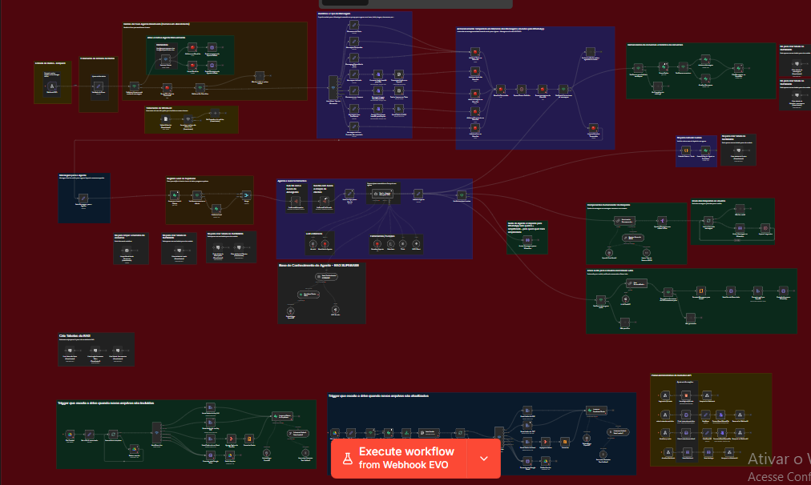
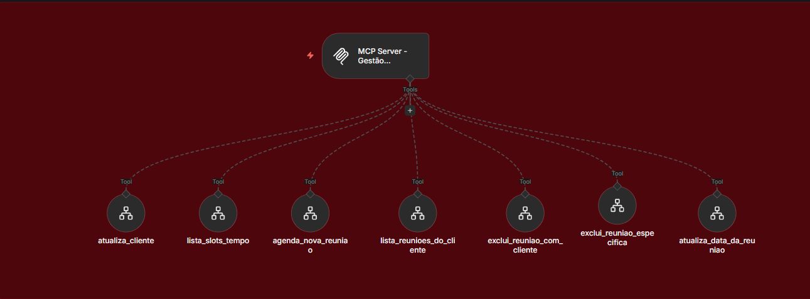
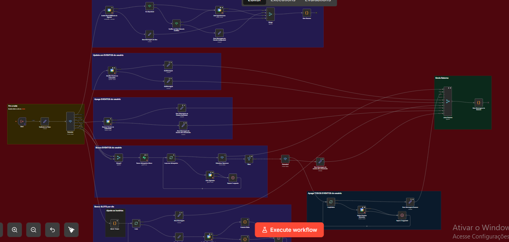

# Assistente de advocacia no WhatsApp com RAG e multiagenda

Um cliente escreve ao escritório pelo WhatsApp, pergunta se a equipe atende questões trabalhistas e pede um horário. A Camis, agente de atendimento, pode consultar os documentos do escritório para responder à primeira pergunta. Para a segunda, consulta os advogados cadastrados e os horários disponíveis no Google Calendar. A confirmação depende da disponibilidade da agenda escolhida.

O projeto organiza o atendimento em cinco workflows do **n8n**. A Camis conduz a conversa com apoio de modelos da **OpenAI**. A busca documental usa **RAG** (geração aumentada por recuperação), e o servidor **MCP** (Model Context Protocol) expõe as ferramentas de cadastro e agendamento. Na arquitetura multiagente, essas responsabilidades aparecem de formas diferentes no editor: há um agente principal, uma ferramenta de consulta à base com modelo próprio e subfluxos que executam as operações de banco e calendário.

## Do WhatsApp à resposta

A **Evolution API** entrega a mensagem ao webhook do n8n. O fluxo identifica o formato: aproveita o texto, transcreve áudio com OpenAI, descreve imagens ou extrai texto de PDFs. O **Redis** reúne mensagens consecutivas do mesmo contato e mantém a memória da conversa. Assim, se o cliente enviar a dúvida e completar a frase em outra mensagem, o agente pode considerar as duas juntas.

Antes de responder, o fluxo consulta o cadastro do cliente e busca os profissionais disponíveis no cadastro do escritório. O **Supabase**, sobre **PostgreSQL**, guarda os dados de clientes, leads e advogados. O fluxo também prevê histórico de mensagens e registro de consumo do modelo. A resposta volta pelo WhatsApp, com síntese de voz opcional via ElevenLabs.

## Como o agente consulta os documentos

Dois gatilhos monitoram a criação e a atualização de arquivos em uma pasta do **Google Drive**. O fluxo baixa o arquivo e escolhe como ler o conteúdo, com caminhos para PDF, texto e planilhas. Em seguida, divide o conteúdo em trechos, gera embeddings com OpenAI e os grava no Supabase usando **pgvector**. Quando um arquivo é atualizado, o fluxo prevê a remoção dos trechos da versão anterior antes da nova indexação.

Durante o atendimento, a Camis pode chamar a ferramenta de conhecimento para pesquisar trechos por semelhança de significado. A [base de exemplo do escritório LexPrime](docs/base-de-conhecimento.txt) descreve áreas de atuação como direito empresarial, trabalhista e imobiliário. Para responder sobre horários livres, o agente consulta o calendário, que reflete os eventos agendados.

## Como funciona a multiagenda

O servidor MCP oferece sete ferramentas ao agente: atualizar o cadastro do cliente, listar horários livres, agendar uma reunião, listar reuniões do cliente, cancelar uma reunião específica, cancelar reuniões do cliente e remarcar. O subfluxo de agenda consulta os profissionais ativos e usa o calendário correspondente para verificar disponibilidade e operar os eventos. O resultado retorna ao agente para compor a resposta no WhatsApp.

## Workflows incluídos

| Workflow | Responsabilidade |
| --- | --- |
| Agente de Advocacia - MultiAgenda com MCP | Recebe a mensagem, consulta memória e ferramentas, responde ao cliente e mantém a base documental atualizada. |
| buscaAdvogados | Consulta o cadastro de advogados e devolve os dados ao fluxo principal. |
| gestaoCliente | Busca, cria e atualiza cadastros no Supabase. Inclui consulta de CEP via ViaCEP. |
| gestaoAgendasAdvocacia | Calcula horários disponíveis e consulta, cria, altera ou cancela eventos no Google Calendar. |
| gestaoMCPEventosAdvocacia | Disponibiliza as operações de cliente e agenda como ferramentas MCP para o agente. |

## Configuração no n8n

1. Importe cada JSON da [pasta de workflows](workflows) em um workflow separado. Comece por buscaAdvogados, gestaoCliente e gestaoAgendasAdvocacia. Depois importe o servidor MCP e o agente principal.
2. Configure as credenciais de Supabase/PostgreSQL, Redis, OpenAI e Google Drive, Sheets e Calendar nos nós correspondentes. Revise os nós SQL de criação de tabelas, extensão vetorial e função de busca. Cadastre um advogado de teste com um calendário acessível à credencial do Google.
3. No agente principal, selecione a pasta do Drive nos gatilhos File Created e File Updated. Configure também a planilha de contatos usada em Valida WhiteList. Com o monitoramento habilitado, envie a base de exemplo para a pasta e confira a inserção dos trechos no banco.
4. Confira os vínculos após importar. No agente principal, fncBuscaCriaUsuario chama gestaoCliente e fncBuscaAdvogados chama buscaAdvogados. No servidor MCP, atualiza_cliente chama gestaoCliente. As outras seis ferramentas chamam gestaoAgendasAdvocacia. Se a instância gerar novos IDs, selecione os workflows locais nos respectivos nós.
5. Configure o endpoint do servidor no nó MCP Client. Substitua os domínios de exemplo nos nós da Evolution API e na página do QR Code pelos endereços da instalação. Conecte uma instância de teste do WhatsApp ao Webhook EVO. Para habilitar voz, configure a chave e a voz do ElevenLabs em Variáveis do Fluxo.
6. Teste primeiro uma pergunta sobre os serviços descritos na base. Em seguida, peça horários e confirme um agendamento em um calendário de teste. Confira tanto o evento criado quanto a mensagem devolvida ao WhatsApp.

Os arquivos são distribuídos desativados, sem credenciais vinculadas nem dados de execução fixados. A execução integrada depende das contas, do banco e das agendas configurados na instalação.
